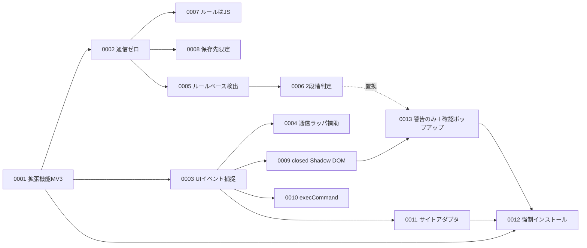

# アーキテクチャ決定記録（ADR）

`docs/pii-guard-development-doc.md` の設計を、意思決定の単位に分解して記録したもの。
実装や運用で「なぜこうなっているのか」を辿るための一次情報とする。

## 記法

- 1決定＝1ファイル。ファイル名は `NNNN-短い決定名.md`
- 決定は**変更しない**。方針が変わった場合は新しいADRを追加し、古いADRのステータスを `置換（ADR-NNNN による）` に変える
- ステータス：`採用` / `採用（要再評価）` / `却下` / `置換`

## 一覧

| ID | 決定 | ステータス | 関連する設計章 |
| --- | --- | --- | --- |
| [0001](0001-browser-extension-mv3.md) | 対策の実装形態をChromium系ブラウザ拡張（MV3）とする | 採用 | 1.2, 2.4 |
| [0002](0002-zero-network-standalone.md) | 拡張機能を完全スタンドアロン（外部通信ゼロ）とし4層で担保する | 採用 | 1.3, 6.1 |
| [0003](0003-isolated-world-ui-capture.md) | 主防御をISOLATED worldでのUIイベントcapture捕捉に置く | 採用 | 4.4, 6.4 |
| [0004](0004-network-wrapper-optional.md) | MAIN worldの通信ラッパは既定OFFの補助層とする | 採用 | 4.5, 5.10 |
| [0005](0005-rule-based-detection.md) | 検出方式をルールベース（正規表現＋検証桁＋文脈スコア）とする | 採用 | 3 |
| [0006](0006-two-level-judgement-fail-closed.md) | 判定をブロック／警告の2段階とし、例外時はfail-closedとする | 置換（ADR-0013 による） | 1.3, 2.2, 5.6 |
| [0007](0007-rules-as-js-not-json.md) | 検出ルールをJSONではなくJSモジュールとして同梱する | 採用 | 5.1 |
| [0008](0008-storage-local-managed-only.md) | 保存先を `storage.local` と `storage.managed` に限定し、検出値を保存しない | 採用 | 6.3, 5.9 |
| [0009](0009-closed-shadow-dom-ui.md) | ブロックUIをclosed Shadow DOMに描画する | 採用 | 5.7, 6.4 |
| [0010](0010-exec-command-for-masking.md) | 入力欄の書き換えに `document.execCommand` を用いる | 採用（要再評価） | 5.6 |
| [0011](0011-site-adapter-separation.md) | サイト依存部をアダプタに分離し汎用セレクタでフォールバックする | 採用 | 2.2, 4.4, 5.5 |
| [0012](0012-forced-install-policy-distribution.md) | 配布をエンタープライズポリシーによる強制インストールとする | 採用 | 8.1, 8.2 |
| [0013](0013-warn-only-with-confirm-popup.md) | 既定の判定を警告のみとし、送信前の確認ポップアップで止める | 採用 | 1.3, 3.1, 5.7 |

## 依存関係

