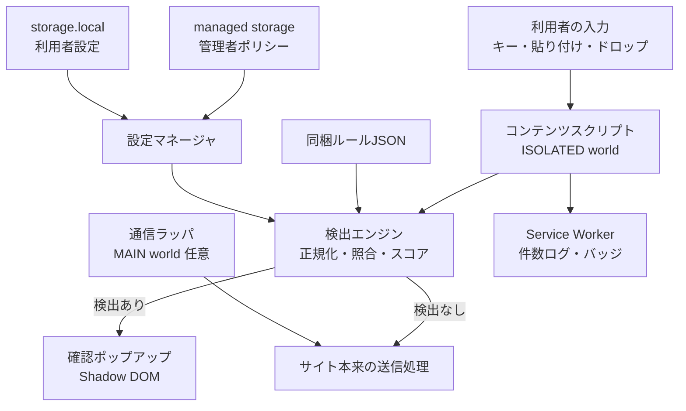
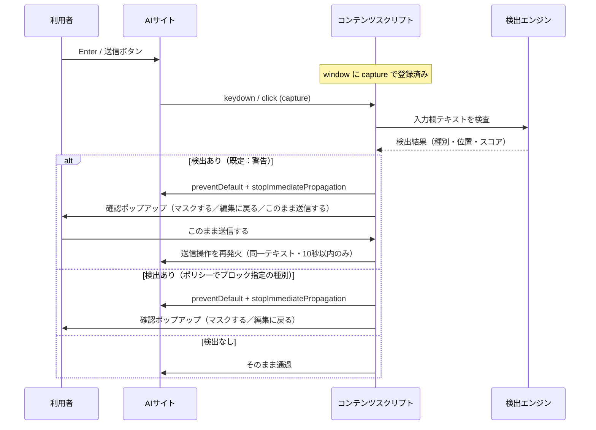

# AIチャット向け個人情報ブロック拡張機能 開発ドキュメント

作成日：2026-09-19

## 1. 概要

本拡張機能は、ブラウザ上の生成AIチャット（ChatGPT、Claude、Gemini、Copilot等）への送信直前に入力テキストを端末内で検査し、健康保険の被保険者番号などの個人情報を検出したら送信をいったん止め、確認ポップアップで利用者に知らせる。検査・判定・ログはすべて端末内で完結し、拡張機能自身は一切の外部通信を行わない。

### 1.1 目的

- 業務端末から外部AIサービスへの個人情報・要配慮個人情報の誤入力を未然に防ぐ
- 利用者に「なぜ止められたか」をその場で示し、マスクして送信する等の代替手段を提示する
- 外部通信を持たないことで、拡張機能自体が新たな情報漏えい経路にならないことを保証する

### 1.2 スコープ

| 区分 | 対象内 | 対象外（本バージョン） |
| --- | --- | --- |
| 入力経路 | キー入力、貼り付け、ドラッグ＆ドロップのテキスト、送信ボタン・Enter送信 | 画像内文字（OCR）、音声入力 |
| ファイル | テキスト系ファイル（.txt/.csv/.md）の内容検査、または添付自体の禁止 | PDF・Office・画像ファイルの中身解析 |
| ブラウザ | Chrome / Edge（Manifest V3） | Firefox・Safari（将来対応、7章参照） |
| 利用形態 | ブラウザのWeb版AIチャット | デスクトップアプリ、スマホアプリ、API直接利用 |

### 1.3 前提・設計原則

1. **完全スタンドアロン**：`fetch`・`XMLHttpRequest`・`WebSocket`・`sendBeacon` を拡張機能コードで使用しない。検出ルールは拡張機能に同梱する。
2. **検出値を保存しない**：ログには種別・件数・時刻・サイトのみを残し、検出した番号そのものは保存しない。
3. **ガードレールであり完全なDLPではない**：意図的な回避（画像化、分割入力、別ブラウザ）は防げない前提で、組織の運用ルール・ブラウザポリシーと組み合わせる。
4. **止めるのではなく気づかせる**：ルールベースの検出では誤検知を避けられないため、既定の判定はすべて警告とする。検出時は送信をいったん止めて確認ポップアップを表示し、利用者が承認したときのみ送信する。ブロック（送信不可）は、管理者ポリシーで種別ごとに有効化した場合にのみ適用する。

## 2. 要件定義

### 2.1 機能要件

| ID | 要件 | 優先度 |
| --- | --- | --- |
| F-01 | 対象AIサイトの入力欄（textarea / contenteditable）のテキストを送信前に検査する | 必須 |
| F-02 | Enterキー送信・送信ボタンクリック・フォーム送信をキャプチャ段階で捕捉し、検出時に送信を中止する | 必須 |
| F-03 | 貼り付け（paste）・ドロップ（drop）時点で検査し、検出時は貼り付けを止めて警告する | 必須 |
| F-04 | 検出時にモーダルで「検出種別」「マスク済みの該当箇所」「対処方法」を表示する | 必須 |
| F-05 | 「該当箇所をマスクして入力欄に戻す」操作を提供する | 必須 |
| F-06 | 検出時は送信をいったん止めて確認ポップアップを表示し、承認時のみ送信する。既定はすべて警告とし、ブロック（送信不可）は管理者ポリシーで有効化した種別にのみ適用する | 必須 |
| F-07 | 入力中にリアルタイムで検出状況を入力欄付近にバッジ表示する | 推奨 |
| F-08 | 検出ルールのON/OFF、カスタム正規表現、キーワード辞書を設定画面で編集できる | 推奨 |
| F-09 | 管理者がポリシー（managed storage）で設定を固定し、利用者が変更できないようにする | 必須（組織配布時） |
| F-10 | 検出イベントを端末内に記録し、件数を設定画面で確認できる（値は保存しない） | 推奨 |
| F-11 | テキスト系ファイル添付時に内容を検査する。または対象サイトでのファイル添付自体を禁止する | 推奨 |
| F-12 | 最終防御として、ページの通信（fetch / XHR / WebSocket）の送信本文を検査する層を任意で有効化できる | 任意 |

### 2.2 非機能要件

| 区分 | 要件 |
| --- | --- |
| 通信 | 拡張機能は外部通信を一切行わない。ネットワーク系APIを使用しないことをビルド時に機械チェックする |
| 性能 | 1万文字の入力に対し検査を50ms以内で完了する。入力中の検査は300msのデバウンスをかける |
| 権限 | 対象AIドメインのみを `host_permissions` / `matches` に指定し、`<all_urls>` は使わない |
| 保守性 | サイトごとのDOMセレクタを設定ファイルに分離し、サイト側の画面改修に設定変更だけで追従できる |
| 可用性 | 拡張機能の例外発生時は「安全側」に倒し、送信をいったん止めてエラーを表示する（fail-closed）。利用者は内容を確認のうえ続行できる |
| 多言語 | UIは日本語。全角数字・全角ハイフン・空白混在の入力を正規化して検出する |

### 2.3 対象サイト（初期値）

| サービス | 対象URLパターン |
| --- | --- |
| ChatGPT | `https://chatgpt.com/*`, `https://chat.openai.com/*` |
| Claude | `https://claude.ai/*` |
| Gemini | `https://gemini.google.com/*` |
| Microsoft Copilot | `https://copilot.microsoft.com/*` |
| Perplexity | `https://www.perplexity.ai/*` |

URLとDOM構造は各サービスの改修で変わるため、リリースごとに実機確認する（7章）。社内で許可していないAIサービスは、本拡張ではなくブラウザポリシーのURLブロックで遮断する方針を推奨する。

### 2.4 対象ブラウザ

Google Chrome および Microsoft Edge の現行安定版（Manifest V3）。いずれもChromium系のため同一コードで動作する。

## 3. 検出対象と検出ルール

検出は「正規化 → パターン照合 → チェックディジット検証 → 文脈キーワードによるスコア加算 → 判定」の順で行う。番号だけでは他の数字と区別できないもの（被保険者記号・番号など）は、周辺のキーワードと組み合わせて判定する。

### 3.1 検出対象一覧

| 種別 | 形式 | 検証方法 | 既定の判定 |
| --- | --- | --- | --- |
| 保険者番号 | 8桁（法別2＋都道府県2＋保険者別3＋検証1）、国保は6桁 | 検証番号（3.3） | 警告（強調） |
| 被保険者記号・番号 | 記号・番号とも保険者ごとに可変長（英数字・記号混在）、枝番2桁 | チェックディジットなし。キーワード必須 | 警告（強調） |
| 後期高齢者医療 被保険者番号 | 8桁 | キーワード＋桁数（検証方式は要確認） | 警告（強調） |
| 公費負担者番号／受給者番号 | 8桁／7桁 | 検証番号（要確認）＋キーワード | 警告（強調） |
| マイナンバー（個人番号） | 12桁 | 検査用数字（3.4） | 警告（強調） |
| 基礎年金番号 | 4桁-6桁（計10桁） | キーワード必須 | 警告（強調） |
| 運転免許証番号 | 12桁 | キーワード＋桁数 | 警告（参考） |
| パスポート番号 | 英字2桁＋数字7桁 | キーワード＋形式 | 警告（参考） |
| クレジットカード番号 | 14〜16桁 | Luhn | 警告（強調） |
| 電話番号 | 0から始まる10〜11桁 | 形式 | 警告（参考） |
| メールアドレス | RFC簡易形式 | 形式 | 警告（参考） |
| 生年月日＋氏名らしき語 | 和暦・西暦の日付＋キーワード | 組み合わせ | 警告（参考） |
| 病名・診療情報（要配慮） | 辞書（「診断」「病名」「処方」等） | 番号と同時出現で加点 | 警告（参考） |

既定の判定はすべて警告であり、送信は確認ポップアップでいったん止まるが、利用者の承認で送信できる。「強調」と「参考」は表示上の重要度の差であり、送信可否は変わらない。管理者ポリシーで種別を指定した場合のみ、その種別の「強調」がブロック（送信不可）になる。

「要確認」の項目は、実装前に厚生労働省・各保険者の公式な番号設定資料で桁構成と検証方式を確認すること。確認できるまではキーワード必須の判定に留め、チェックディジットでの絞り込みは行わない。

### 3.2 正規化処理

照合前に入力テキストへ以下を適用し、元テキストとの位置対応表を保持する（マスク時に元の位置を置換するため）。

1. `String.prototype.normalize('NFKC')` で全角英数字・全角記号を半角化する
2. ハイフン類（`‐ - – — − ー ｰ`）を `-` に統一する
3. 数字の間の空白・ハイフン・ドットを取り除いた「数字列ビュー」を別途作る（例：`0613 0017` → `06130017`）
4. 漢数字（〇一二三…）の数字化は誤検知が多いため初期版では行わず、将来オプションとする

### 3.3 保険者番号の検証番号

末尾1桁を除いた各桁に、下位（右）の桁から順に 2, 1, 2, 1… の重みを掛け、各積の各位の数字を合計する。合計の1の位を10から引いた値が検証番号（1の位が0なら0）。Luhnアルゴリズムと同じ計算になる。

例：`0613001` → 右から 1×2, 0×1, 0×2, 3×1, 1×2, 6×1, 0×2 → 合計13 → 10−3＝7 → 保険者番号 `06130017`（テスト用のダミー値）

### 3.4 マイナンバーの検査用数字

上位11桁を右から P1…P11 とし、重み Qn を n≦6 なら n+1、n≧7 なら n−5 とする。

```latex
R = \left(\sum_{n=1}^{11} P_n Q_n\right) \bmod 11,\quad \text{check} = \begin{cases} 0 & (R \le 1) \\ 11 - R & (R \ge 2) \end{cases}
```

例：`12345678901` → 合計212、212 mod 11＝3 → 検査用数字8 → `123456789018`（テスト用のダミー値）

### 3.5 文脈キーワードとスコアリング

候補ごとに前後40文字をキーワード辞書と照合し、スコアを合算する。

| 要素 | 加点 |
| --- | --- |
| 形式一致（桁数・並び） | +30 |
| チェックディジット一致 | +40 |
| 強キーワード（被保険者、保険者番号、記号、保険証、マイナンバー、個人番号、基礎年金番号） | +40 |
| 弱キーワード（番号、No、患者、受診、カルテ、氏名、生年月日） | +15 |
| 否定キーワード（注文番号、型番、請求書番号、郵便番号、ISBN） | −40 |

**判定**：70点以上は警告（強調表示）、40〜69点は警告（参考表示）、39点以下は通過。いずれも送信は確認ポップアップでいったん止まり、利用者の承認で送信できる。管理者ポリシーで当該種別をブロックに指定した場合のみ、70点以上が送信不可になる。閾値とキーワードは設定ファイルで調整可能にし、7章の評価データで決定する。

### 3.6 ルール定義フォーマット

ルールは拡張機能に同梱するJSONで定義し、管理者は managed storage で追加・上書きできる。同梱ルールの `action` は例外なく `warn` とし、`block` は管理者ポリシーでの上書きにのみ使う。

```json
{
  "id": "insurer_number",
  "label": "保険者番号",
  "pattern": "(?<![0-9])(?:[0-9]{8}|[0-9]{6})(?![0-9])",
  "validator": "insurerCheckDigit",
  "keywords": { "strong": ["保険者番号", "保険証"], "weak": ["番号"], "negative": ["注文番号", "郵便番号"] },
  "action": "warn",
  "enabled": true
}
```

## 4. アーキテクチャ設計

Manifest V3の拡張機能として、対象AIサイトにコンテンツスクリプトを注入し、利用者の送信操作をキャプチャ段階で横取りして検査する。任意で、ページの通信APIをラップする最終防御層（MAIN world）を追加する。

### 4.1 構成図



通信の流れはブラウザ内部（コンテンツスクリプト ⇄ Service Worker のメッセージング）に閉じており、外部への矢印は存在しない。

### 4.2 コンポーネント

| コンポーネント | 実行場所 | 役割 |
| --- | --- | --- |
| コンテンツスクリプト `content.js` | 対象ページ（ISOLATED world）、`document_start` | 入力欄の特定、イベント捕捉、送信の中止、UI表示 |
| 検出エンジン `detector.js` | コンテンツスクリプト内（同一ファイルに同梱） | 正規化、正規表現照合、チェックディジット、スコアリング |
| サイトアダプタ `sites.json` | 同梱設定 | サービスごとの入力欄・送信ボタンのセレクタ |
| 確認ポップアップ `modal.js` | Shadow DOM（closed） | 検出内容の表示、マスク操作、送信の承認、ページCSSからの隔離 |
| Service Worker `background.js` | 拡張機能 | 検出件数の記録、ツールバーバッジ、設定変更の配信 |
| 設定画面 `options.html` | 拡張機能ページ | ルールのON/OFF、カスタムルール、件数表示 |
| 通信ラッパ `net-guard.js` | 対象ページ（MAIN world）、任意 | `fetch` / `XMLHttpRequest.send` / `WebSocket.send` の本文検査 |

### 4.3 送信時の確認シーケンス



### 4.4 イベント捕捉の方針

- リスナーは `window` に `capture: true` で登録し、サイト側のハンドラより先に実行する。`document_start` で登録することで、サイトのスクリプトより先に登録される
- 捕捉するイベント：`keydown`（Enter、Ctrl/Cmd+Enter、IME変換中の `isComposing` は除外）、`click` / `pointerdown`（送信ボタン）、`submit`、`paste`、`drop`、`beforeinput`（`insertFromPaste` / `insertFromDrop`）
- 送信ボタンは `sites.json` のセレクタで特定し、見つからない場合は `button[type=submit]` と `aria-label` に「送信」「Send」を含むボタンを汎用候補とする
- SPAの画面遷移で入力欄が作り直されるため、`MutationObserver` で入力欄の出現を監視する
- 入力欄の種類：ChatGPT・ClaudeなどはProseMirror系の `contenteditable`、一部は `textarea`。テキスト取得は `textarea.value` または `element.innerText`

### 4.5 最終防御層（通信ラッパ）の位置づけ

UIイベントの捕捉はサイトの改修（ボタン構造の変更、新しい送信ショートカット）で漏れる可能性がある。そこで任意機能として、MAIN worldに注入したスクリプトで `window.fetch` 等をラップし、AIサービスのAPIへ送られるリクエスト本文を送信直前に検査する。

- 利点：送信経路がUIのどこであっても、最終的なリクエスト本文を検査できる
- 欠点：ページ側から改変・回避されうる、サイトの動作を壊すリスクがある、本文形式（JSON・ストリーム）がサービスごとに異なる
- 方針：既定はOFF。有効時は検出したら例外を投げて送信を失敗させ、コンテンツスクリプトへ `postMessage` で通知してモーダルを表示する

Chrome の `webRequest` による本文の閲覧・遮断は、MV3ではポリシー強制インストールの拡張機能に限り blocking が使えるが、本文の扱いに制約が多いため本設計では採用しない。

## 5. 詳細設計とサンプルコード

以下は実装の骨格となるサンプルである。サイトのセレクタ等は実装時点の実画面で必ず確認すること。

### 5.1 ディレクトリ構成

```
pii-guard/
├── manifest.json
├── schema.json            # managed storage（管理者ポリシー）のスキーマ
├── src/
│   ├── rules.js           # 検出ルール定義（JSONではなくJSとして同梱）
│   ├── detector.js        # 検出エンジン
│   ├── sites.js           # サイト別セレクタ
│   ├── modal.js           # 確認ポップアップ（Shadow DOM）
│   ├── content.js         # イベント捕捉・送信制御
│   ├── net-guard.js       # 任意：通信ラッパ（MAIN world）
│   └── background.js      # Service Worker：件数記録・設定配信
├── options/               # 設定画面 options.html / options.js / options.css
├── icons/
├── test/                  # detector.test.js / vectors.json
└── scripts/
    └── check-no-network.mjs  # 外部通信APIの混入チェック
```

ルールを `rules.json` ではなく `rules.js` とするのは、コンテンツスクリプトから `fetch(chrome.runtime.getURL(...))` で読む必要をなくし、コード中の `fetch` 使用を例外なくゼロにするためである。

### 5.2 manifest.json

```json
{
  "manifest_version": 3,
  "name": "AI入力 個人情報ガード",
  "version": "1.0.0",
  "description": "生成AIチャットへの個人情報の送信を端末内で検出し、送信前に確認します（外部通信なし）",
  "minimum_chrome_version": "111",
  "permissions": ["storage", "scripting"],
  "host_permissions": [
    "https://chatgpt.com/*",
    "https://chat.openai.com/*",
    "https://claude.ai/*",
    "https://gemini.google.com/*",
    "https://copilot.microsoft.com/*",
    "https://www.perplexity.ai/*"
  ],
  "background": { "service_worker": "src/background.js" },
  "content_scripts": [
    {
      "matches": [
        "https://chatgpt.com/*",
        "https://chat.openai.com/*",
        "https://claude.ai/*",
        "https://gemini.google.com/*",
        "https://copilot.microsoft.com/*",
        "https://www.perplexity.ai/*"
      ],
      "js": ["src/rules.js", "src/detector.js", "src/sites.js", "src/modal.js", "src/content.js"],
      "run_at": "document_start",
      "all_frames": true
    }
  ],
  "action": { "default_title": "AI入力 個人情報ガード" },
  "options_page": "options/options.html",
  "storage": { "managed_schema": "schema.json" },
  "content_security_policy": {
    "extension_pages": "default-src 'self'; script-src 'self'; object-src 'none'; connect-src 'none'"
  },
  "icons": { "48": "icons/48.png", "128": "icons/128.png" }
}
```

`scripting` と `host_permissions` は、任意機能の通信ラッパを設定に応じて `chrome.scripting.registerContentScripts` で登録するためだけに使う。通信ラッパを実装しない場合は両方とも削除し、権限をさらに絞る。

### 5.3 検出ルール（rules.js）

```js
// src/rules.js — 同梱ルール。管理者ポリシーで無効化・追加が可能
globalThis.PII_RULES = [
  // 同梱ルールの action は例外なくすべて 'warn'。'block' は管理者ポリシーでの上書き専用
  {
    id: 'insurer_number', label: '保険者番号', kind: 'numeric',
    lengths: [6, 8], validator: 'luhn', action: 'warn',
    // 6・8桁の数字は10%の確率で偶然検証を通るため、キーワードがなければ「参考」に留める
    requireKeywordForHigh: true,
    keywords: { strong: ['保険者番号', '保険証', '保険者'], weak: ['番号', 'No'], negative: ['注文番号', '郵便番号', '型番', '請求書'] }
  },
  {
    id: 'insured_symbol_number', label: '被保険者記号・番号', kind: 'regex',
    pattern: '(?:記号)\\s*[:：]?\\s*[0-9A-Za-z\\-]{1,10}\\s*[・,、 ]?\\s*(?:番号)\\s*[:：]?\\s*[0-9]{1,10}',
    baseScore: 70, action: 'warn'
  },
  {
    id: 'insured_number_kw', label: '被保険者番号', kind: 'regex',
    pattern: '(?:被保険者番号|被保番号|保険証番号)\\s*[:：]?\\s*[0-9A-Za-z\\-]{4,12}',
    baseScore: 70, action: 'warn'
  },
  {
    id: 'my_number', label: 'マイナンバー', kind: 'numeric',
    lengths: [12], validator: 'myNumber', action: 'warn',
    keywords: { strong: ['マイナンバー', '個人番号'], weak: ['番号'], negative: [] }
  },
  {
    id: 'pension_number', label: '基礎年金番号', kind: 'numeric',
    lengths: [10], validator: null, action: 'warn', requireKeyword: true,
    keywords: { strong: ['基礎年金番号', '年金番号', '年金手帳'], weak: [], negative: [] }
  },
  {
    id: 'credit_card', label: 'クレジットカード番号', kind: 'numeric',
    lengths: [14, 15, 16], validator: 'luhn', action: 'warn',
    keywords: { strong: ['カード番号', 'クレジット'], weak: [], negative: [] }
  },
  {
    id: 'phone', label: '電話番号', kind: 'regex',
    pattern: '(?<![0-9])0[0-9]{1,4}-?[0-9]{1,4}-?[0-9]{3,4}(?![0-9])',
    baseScore: 40, action: 'warn'
  },
  {
    id: 'email', label: 'メールアドレス', kind: 'regex',
    pattern: '[A-Za-z0-9._%+-]+@[A-Za-z0-9.-]+\\.[A-Za-z]{2,}',
    baseScore: 40, action: 'warn'
  }
];
```

### 5.4 検出エンジン（detector.js）

```js
// src/detector.js
globalThis.Detector = (() => {
  const DASHES = /[‐‑‒–—―−ー]/;

  // 1文字ずつNFKC正規化し、正規化後の各文字が元テキストの何文字目に対応するかを記録する
  function normalizeWithMap(src) {
    let text = '';
    const map = [];
    let i = 0;
    for (const ch of src) {
      const n = ch.normalize('NFKC');
      for (let k = 0; k < n.length; k++) { text += n[k]; map.push(i); }
      i += ch.length;
    }
    map.push(i);
    // 数字に挟まれたハイフン類だけを '-' に統一（長音「ー」を壊さないため）
    text = text.replace(/(?<=[0-9])[‐‑‒–—―−ー](?=[0-9])/g, '-');
    return { text, map };
  }

  function luhn(d) {
    let sum = 0;
    for (let i = d.length - 1, pos = 0; i >= 0; i--, pos++) {
      let v = d.charCodeAt(i) - 48;
      if (pos % 2 === 1) { v *= 2; if (v > 9) v -= 9; }
      sum += v;
    }
    return sum % 10 === 0;
  }

  function myNumber(d) {
    if (!/^[0-9]{12}$/.test(d)) return false;
    let sum = 0;
    for (let n = 1; n <= 11; n++) {
      const p = d.charCodeAt(11 - n) - 48;
      const q = n <= 6 ? n + 1 : n - 5;
      sum += p * q;
    }
    const r = sum % 11;
    return (r <= 1 ? 0 : 11 - r) === d.charCodeAt(11) - 48;
  }

  const VALIDATORS = { luhn, myNumber };

  function keywordScore(text, start, end, kw = {}) {
    const ctx = text.slice(Math.max(0, start - 40), Math.min(text.length, end + 40));
    const has = (list) => (list || []).some((k) => ctx.includes(k));
    let s = 0;
    if (has(kw.strong)) s += 40;
    if (has(kw.weak)) s += 15;
    if (has(kw.negative)) s -= 40;
    return { score: s, strong: has(kw.strong) };
  }

  // 区切り（空白・ハイフン・ドット）を挟んだ数字列を候補として抽出
  const NUMERIC_RUN = /(?<![0-9])[0-9](?:[ \-.]?[0-9]){3,18}(?![0-9])/g;

  function detect(src, { rules = globalThis.PII_RULES, thresholds = { high: 70, low: 40 } } = {}) {
    const { text, map } = normalizeWithMap(src);
    const findings = [];

    const push = (rule, start, end, score) => {
      // 既定は rule.action === 'warn'。'block' は管理者ポリシーで指定された種別のみ
      let level = 'pass';
      if (score >= thresholds.high) level = rule.action;    // 'warn'（既定）または 'block'
      else if (score >= thresholds.low) level = 'notice';   // 参考表示の警告
      if (level === 'pass') return;
      findings.push({ ruleId: rule.id, label: rule.label, level, score,
                      start: map[start], end: map[end] });  // 元テキスト上の位置
    };

    const numericRules = rules.filter((r) => r.enabled !== false && r.kind === 'numeric');
    for (const m of text.matchAll(NUMERIC_RUN)) {
      const digits = m[0].replace(/[^0-9]/g, '');
      const start = m.index, end = m.index + m[0].length;
      for (const rule of numericRules) {
        if (!rule.lengths.includes(digits.length)) continue;
        let score = 30;                                     // 形式一致
        if (rule.validator) {
          if (!VALIDATORS[rule.validator](digits)) continue;  // 検証失敗は対象外
          score += 40;
        }
        const kw = keywordScore(text, start, end, rule.keywords);
        if (rule.requireKeyword && !kw.strong) continue;
        score += kw.score;
        if (rule.requireKeywordForHigh && !kw.strong) score = Math.min(score, thresholds.high - 1);
        push(rule, start, end, score);
      }
    }

    for (const rule of rules.filter((r) => r.enabled !== false && r.kind === 'regex')) {
      const re = new RegExp(rule.pattern, 'g');
      for (const m of text.matchAll(re)) {
        const start = m.index, end = m.index + m[0].length;
        const kw = keywordScore(text, start, end, rule.keywords);
        push(rule, start, end, (rule.baseScore ?? 30) + kw.score);
      }
    }
    return dedupe(findings);
  }

  // 同じ範囲に複数ルールが当たった場合は、level が強くスコアの高いものを残す
  function dedupe(fs) {
    const rank = { block: 3, warn: 2, notice: 1 };
    fs.sort((a, b) => a.start - b.start || rank[b.level] - rank[a.level] || b.score - a.score);
    const out = [];
    for (const f of fs) {
      const last = out[out.length - 1];
      if (last && f.start < last.end) continue;
      out.push(f);
    }
    return out;
  }

  // 検出箇所を「[保険者番号]」のようなラベルに置換（AIへの文脈は残しつつ値は消す）
  function mask(src, findings) {
    let out = src;
    for (const f of [...findings].sort((a, b) => b.start - a.start)) {
      out = out.slice(0, f.start) + `[${f.label}]` + out.slice(f.end);
    }
    return out;
  }

  // UI表示用：先頭数桁以外を伏せる
  function preview(value) {
    return value.length <= 4 ? '*'.repeat(value.length) : value.slice(0, 2) + '*'.repeat(value.length - 2);
  }

  return { detect, mask, preview, _internal: { luhn, myNumber, normalizeWithMap } };
})();
```

### 5.5 サイトアダプタ（sites.js）

```js
// src/sites.js — セレクタは例。各サービスの画面改修で変わるため実画面で確認すること
globalThis.PII_SITES = {
  'chatgpt.com':          { editor: '#prompt-textarea',                     sendButton: 'button[data-testid="send-button"]' },
  'claude.ai':            { editor: 'div.ProseMirror[contenteditable="true"]', sendButton: 'button[aria-label*="Send"]' },
  'gemini.google.com':    { editor: 'rich-textarea [contenteditable="true"]',  sendButton: 'button[aria-label*="送信"], button[aria-label*="Send"]' },
  'copilot.microsoft.com':{ editor: 'textarea',                              sendButton: 'button[aria-label*="Submit"], button[aria-label*="送信"]' },
  'www.perplexity.ai':    { editor: 'textarea, [contenteditable="true"]',    sendButton: 'button[aria-label*="Submit"]' }
};
globalThis.PII_GENERIC = {
  editor: 'textarea, [contenteditable="true"], [contenteditable=""]',
  sendButton: 'button[type="submit"], button[aria-label*="送信"], button[aria-label*="Send"]'
};
```

### 5.6 イベント捕捉と送信制御（content.js）

```js
// src/content.js
(() => {
  const site = globalThis.PII_SITES[location.hostname] || globalThis.PII_GENERIC;
  let settings = { thresholds: { high: 70, low: 40 }, rules: globalThis.PII_RULES, blockFiles: true };
  let approved = null;  // 利用者が確認ポップアップで承認した { text, until }

  // 設定の読込：管理者ポリシー（managed）を利用者設定（local）より優先
  Promise.all([
    chrome.storage.local.get(null),
    chrome.storage.managed.get(null).catch(() => ({}))
  ]).then(([local, managed]) => { settings = mergeSettings(settings, local, managed); });

  const findEditor = (t) => t?.closest?.(site.editor) || t?.closest?.(globalThis.PII_GENERIC.editor);
  const currentEditor = () => document.querySelector(site.editor) || document.activeElement?.closest?.(globalThis.PII_GENERIC.editor);
  const getText = (el) => (el.tagName === 'TEXTAREA' ? el.value : el.innerText);
  const stop = (e) => { e.preventDefault(); e.stopImmediatePropagation(); };

  function check(e, el, mode) {
    const text = getText(el);
    if (!text.trim()) return;
    if (approved && approved.text === text && Date.now() < approved.until) { approved = null; return; }
    let findings;
    try {
      findings = globalThis.Detector.detect(text, settings);
    } catch (err) {
      stop(e);  // fail-closed：検査できなければ、まず止める
      // 業務を止めないため、利用者は内容を確認のうえ続行できる
      globalThis.PiiModal.showError({ onProceed: () => { approved = { text, until: Date.now() + 10_000 }; } });
      return;
    }
    if (!findings.length) return;
    stop(e);
    report(findings);
    // 既定では block レベルは発生しないため canProceed は true。ポリシー指定時のみ false
    const blocked = findings.some((f) => f.level === 'block');
    globalThis.PiiModal.show({
      mode, findings, text, canProceed: !blocked,
      onMask: () => replaceEditorText(el, globalThis.Detector.mask(text, findings)),
      onProceed: () => { approved = { text, until: Date.now() + 10_000 }; }  // 10秒以内の再送信のみ許可
    });
  }

  // Enter送信（IME変換確定のEnter、Shift+Enterの改行は除外）
  window.addEventListener('keydown', (e) => {
    if (e.key !== 'Enter' || e.isComposing || e.keyCode === 229 || e.shiftKey) return;
    const el = findEditor(e.target);
    if (el) check(e, el, 'send');
  }, true);

  // 送信ボタン（サイトによっては pointerdown で送信するため両方を捕捉）
  for (const type of ['pointerdown', 'click']) {
    window.addEventListener(type, (e) => {
      if (!e.target?.closest?.(site.sendButton)) return;
      const el = currentEditor();
      if (el) check(e, el, 'send');
    }, true);
  }

  // 貼り付け・ドロップ：入力欄に入る前に検査
  function onIncoming(e, data) {
    const el = findEditor(e.target);
    if (!el || !data) return;
    if (data.files?.length && settings.blockFiles) { stop(e); globalThis.PiiModal.showFileBlocked(); return; }
    const text = data.getData('text/plain') || '';
    const findings = globalThis.Detector.detect(text, settings);
    if (!findings.length) return;
    stop(e);
    report(findings);
    globalThis.PiiModal.show({
      mode: 'paste', findings, text, canProceed: !findings.some((f) => f.level === 'block'),
      onMask: () => insertAtCursor(el, globalThis.Detector.mask(text, findings)),
      onProceed: () => insertAtCursor(el, text)   // 「このまま貼り付ける」
    });
  }
  window.addEventListener('paste', (e) => onIncoming(e, e.clipboardData), true);
  window.addEventListener('drop', (e) => onIncoming(e, e.dataTransfer), true);

  // 入力欄の書き換え（React / ProseMirror の内部状態も更新されるよう、ネイティブ操作で行う）
  function replaceEditorText(el, newText) {
    el.focus();
    if (el.tagName === 'TEXTAREA') {
      const setter = Object.getOwnPropertyDescriptor(HTMLTextAreaElement.prototype, 'value').set;
      setter.call(el, newText);
      el.dispatchEvent(new Event('input', { bubbles: true }));
    } else {
      const range = document.createRange();
      range.selectNodeContents(el);
      const sel = window.getSelection();
      sel.removeAllRanges();
      sel.addRange(range);
      document.execCommand('insertText', false, newText);
    }
  }
  function insertAtCursor(el, text) { el.focus(); document.execCommand('insertText', false, text); }

  // 検出件数のみを通知（検出値そのものは渡さない）
  function report(findings) {
    chrome.runtime.sendMessage({
      type: 'detected', site: location.hostname,
      kinds: [...new Set(findings.map((f) => f.ruleId))],
      level: ['block', 'warn', 'notice'].find((lv) => findings.some((f) => f.level === lv))
    }).catch(() => {});
  }

  function mergeSettings(base, local, managed) {
    const locked = managed.lockSettings === true;
    const src = locked ? managed : { ...local, ...managed };
    const disabled = new Set(src.disabledRules || []);
    const toBlock = new Set(src.blockRules || []);   // 既定は空＝すべて警告
    return {
      ...base,
      thresholds: src.thresholds || base.thresholds,
      blockFiles: src.blockFileUpload ?? base.blockFiles,
      rules: [...globalThis.PII_RULES, ...(src.customRules || [])].map((r) => ({
        ...r, enabled: !disabled.has(r.id), action: toBlock.has(r.id) ? 'block' : (r.action || 'warn')
      }))
    };
  }
})();
```

`document.execCommand` は非推奨APIだが、ProseMirror等のリッチエディタの内部状態と整合した書き換えを行う現実的な手段であり、各ブラウザで引き続き動作する。動作しなくなった場合に備え、マスクに失敗したら「マスク済みテキストをクリップボードにコピーし、手動で貼り直してもらう」代替フローを用意する。

### 5.7 確認ポップアップ（modal.js）の仕様

- `attachShadow({ mode: 'closed' })` のShadow DOMに描画し、サイトのCSSの影響とページスクリプトからの参照を防ぐ
- 送信操作（Enter・送信ボタン）や貼り付けをいったん止めた状態で、画面中央にポップアップとして表示する。背景にオーバーレイを敷き、入力欄の操作を一時的に受け付けない
- 表示内容：見出し「個人情報が含まれている可能性があります」、検出種別の一覧（例：保険者番号 `06******`）、判定理由（キーワード・検証番号一致）
- 重要度は表示で区別する：`warn`（強調）はアイコンと色で強く示し、`notice`（参考）は控えめに一覧へ並べる。いずれも送信可否は同じ
- ボタン：「該当箇所をマスクする」「編集に戻る」「このまま送信する」の3つ。「このまま送信する」の押下後、同一テキストかつ10秒以内の再送信のみ許可する
- 貼り付け・ドロップ時は3つ目を「このまま貼り付ける」とする
- 管理者ポリシーでブロックに指定された種別を検出した場合のみ、「このまま送信する」を表示しない
- 誤検知で止められた利用者が1クリックで先へ進めることを優先し、既定のフォーカスは「このまま送信する」以外（「編集に戻る」）に置く
- 検出値は `Detector.preview()` で伏せ字にしてから表示し、完全な値をDOMに書き出さない
- キーボード操作（Tab移動、Escで「編集に戻る」）とフォーカストラップに対応する
- ボタンのクリックは `event.isTrusted` を検証し、ページのスクリプトによる合成クリックでは承認できないようにする（6.4）

### 5.8 Service Worker（background.js）

```js
// src/background.js — 日付×サイト×種別の件数のみを保存。90日で削除
chrome.runtime.onMessage.addListener((msg) => {
  if (msg?.type !== 'detected') return;
  (async () => {
    const { stats = {} } = await chrome.storage.local.get('stats');
    const day = new Date().toISOString().slice(0, 10);
    for (const kind of msg.kinds) {
      const key = `${day}|${msg.site}|${kind}|${msg.level}`;
      stats[key] = (stats[key] || 0) + 1;
    }
    const limit = new Date(Date.now() - 90 * 864e5).toISOString().slice(0, 10);
    for (const k of Object.keys(stats)) if (k.slice(0, 10) < limit) delete stats[k];
    await chrome.storage.local.set({ stats });
    const total = Object.values(stats).reduce((a, b) => a + b, 0);
    chrome.action?.setBadgeText({ text: total ? String(Math.min(total, 999)) : '' });
  })();
});
```

### 5.9 管理者ポリシーのスキーマ（schema.json）

```json
{
  "type": "object",
  "properties": {
    "lockSettings":    { "type": "boolean", "description": "trueで利用者による設定変更を禁止" },
    "disabledRules":   { "type": "array", "items": { "type": "string" } },
    "customRules":     { "type": "array", "items": { "type": "object",
                          "properties": { "id": {"type":"string"}, "label": {"type":"string"}, "kind": {"type":"string"},
                                           "pattern": {"type":"string"}, "baseScore": {"type":"integer"}, "action": {"type":"string"} } } },
    "thresholds":      { "type": "object", "properties": { "high": {"type":"integer"}, "low": {"type":"integer"} } },
    "blockRules":      { "type": "array", "items": { "type": "string" },
                          "description": "ブロック（送信不可）に引き上げる種別のID。既定は空＝すべて警告" },
    "blockFileUpload": { "type": "boolean" },
    "enableNetGuard":  { "type": "boolean" }
  }
}
```

### 5.10 通信ラッパ（net-guard.js、任意）

設定 `enableNetGuard` がtrueのとき、Service Workerが `chrome.scripting.registerContentScripts` で `world: 'MAIN'`、`runAt: 'document_start'` として `rules.js`・`detector.js`・`net-guard.js` を登録する。

```js
// src/net-guard.js — MAIN world。ページの送信本文を最終検査する
(() => {
  // 最終防御層のため、警告レベル（既定）でも送信を止める
  const blocked = (body) => typeof body === 'string' &&
    globalThis.Detector.detect(body).some((f) => f.level === 'block' || f.level === 'warn');
  const notify = () => window.postMessage({ source: 'pii-guard', type: 'net-blocked' }, location.origin);

  const origFetch = window.fetch;
  window.fetch = function (input, init) {
    if (blocked(init?.body)) { notify(); return Promise.reject(new TypeError('Blocked by PII guard')); }
    return origFetch.apply(this, arguments);
  };

  const origSend = XMLHttpRequest.prototype.send;
  XMLHttpRequest.prototype.send = function (body) {
    if (blocked(body)) { notify(); throw new DOMException('Blocked by PII guard', 'AbortError'); }
    return origSend.apply(this, arguments);
  };

  const origWsSend = WebSocket.prototype.send;
  WebSocket.prototype.send = function (data) {
    if (blocked(data)) { notify(); return; }
    return origWsSend.apply(this, arguments);
  };
})();
```

このファイルはページの通信関数を横取りするが、横取りした本文は検査後に破棄するだけで、どこにも転送しない。`Request` オブジェクトや `ReadableStream` の本文は初期版では対象外とし、7章のサイト別テストで各サービスの送信形式を確認して対応範囲を決める。

## 6. セキュリティ・プライバシー設計

外部通信ゼロは「コードに書かない」「ビルドで検出する」「CSPで封じる」「権限を与えない」の4層で担保する。

### 6.1 外部通信ゼロの担保策

| 層 | 対策 | 対象 |
| --- | --- | --- |
| コード | `fetch`・`XMLHttpRequest`（生成）・`WebSocket`（生成）・`EventSource`・`navigator.sendBeacon`・`import()` を使用しない | 全ソース |
| ビルド | `scripts/check-no-network.mjs` で上記APIと `http://`・`https://` 文字列の混入を検出し、見つかればビルド失敗とする（`net-guard.js` のラップ対象参照のみ許可リスト化） | CI・リリース時 |
| CSP | `connect-src 'none'` により、拡張機能ページ（設定画面・Service Worker）からの通信をブラウザが拒否する | 拡張機能ページ |
| 権限 | `webRequest`・`<all_urls>`・`identity`・`tabs` 等を要求しない。`host_permissions` は対象AIドメインのみ | manifest |
| 外部コード | リモートスクリプト・CDNを使わない（MV3でも禁止）。依存ライブラリはゼロを原則とする | 全ソース |
| 検証 | リリース前に DevTools の Network パネルと `chrome://net-export` で拡張機能起点の通信がないことを確認する | 7章 |

コンテンツスクリプトはページのCSPの下で動作するため、拡張機能のCSPでは縛れない。この部分はコード規約とビルド時チェックで担保する。

### 6.2 ビルド時チェックの例

```js
// scripts/check-no-network.mjs
import { readFileSync, readdirSync, statSync } from 'node:fs';
import { join } from 'node:path';

const FORBIDDEN = [/\bfetch\s*\(/, /new\s+XMLHttpRequest/, /new\s+WebSocket/, /EventSource/, /sendBeacon/, /\bimport\s*\(/, /https?:\/\//];
const ALLOW = new Set(['src/net-guard.js']);  // ラップのため参照のみ行うファイル（個別にレビュー）

const files = (dir) => readdirSync(dir).flatMap((f) => {
  const p = join(dir, f);
  return statSync(p).isDirectory() ? files(p) : /\.(js|html)$/.test(p) ? [p] : [];
});

let ng = 0;
for (const f of [...files('src'), ...files('options')]) {
  if (ALLOW.has(f)) continue;
  const src = readFileSync(f, 'utf8');
  for (const re of FORBIDDEN) if (re.test(src)) { console.error(`NG: ${f} matches ${re}`); ng++; }
}
process.exit(ng ? 1 : 0);
```

`manifest.json` の `host_permissions` や `matches` にはURLが含まれるため、このチェックはJS・HTMLのみを対象とする。

### 6.3 データの取り扱い

| データ | 保存場所 | 保存内容 | 保持期間 |
| --- | --- | --- | --- |
| 入力テキスト | 保存しない（メモリ上で検査後に破棄） | ― | ― |
| 検出値 | 保存しない。UIには伏せ字で表示 | ― | ― |
| 検出ログ | `chrome.storage.local` | 日付・サイト・種別・判定レベルごとの件数 | 90日 |
| 利用者設定 | `chrome.storage.local` | ルールON/OFF、カスタムルール | 無期限 |
| 管理者ポリシー | `chrome.storage.managed`（読み取り専用） | ポリシー値 | OSのポリシー設定に従う |

`chrome.storage.sync` はGoogleアカウント経由でクラウド同期されるため使用しない。`console.log` に入力テキストや検出値を出力することも禁止する（開発時のデバッグ出力はビルドで除去する）。

### 6.4 ページからの改ざん対策

- 検出ロジックはISOLATED worldで動作させ、ページのスクリプトから関数や設定を書き換えられないようにする
- 確認ポップアップは closed な Shadow DOM とし、ページ側から「このまま送信する」ボタンを押させる操作を防ぐ（ボタンのクリックは `event.isTrusted` を確認する）。既定の判定が警告のみで、すべての検出にこのボタンが表示される以上、この2点は必須要件とする
- MAIN worldの通信ラッパはページから上書き可能なため、あくまで補助層と位置づけ、主防御はISOLATED worldのイベント捕捉とする
- `window.postMessage` の受信時は `event.source === window`・`event.origin` と `source: 'pii-guard'` を確認し、通知表示以外の処理は行わない

### 6.5 法令・社内規程との関係

健康保険の被保険者記号・番号は、健康保険法等で告知の求めが制限されている情報であり、医療情報と結び付けば要配慮個人情報にも該当しうる。本拡張の導入は技術的安全管理措置の一つであり、利用規程（生成AIへの入力禁止情報の明示）、教育、許可サービスの限定と併せて運用する。具体的な条文や社内規程への当てはめは、法務・情報セキュリティ部門に確認すること。

## 7. テスト計画

テストは検出エンジンの単体テスト、ブラウザ上の結合テスト、対象サイト別の実機テスト、誤検知・見逃し率の評価の4段階で行う。実在の個人情報は一切使わず、チェックディジットを満たすダミー番号を生成して使う。

### 7.1 テスト段階

| 段階 | 手段 | 合格基準 |
| --- | --- | --- |
| 単体 | Node.js ＋ Vitest（または Jest）で `detector.js` を検査 | テストベクタ全件で期待どおりの判定 |
| 結合 | Playwright で拡張機能を読み込んだChromiumを起動し、ローカルのテスト用HTML（textarea版・ProseMirror版）で送信を試行 | 検出時、承認するまで送信ハンドラが呼ばれないこと。承認後は呼ばれること |
| サイト別 | 対象AIサイトごとの手動チェックリスト（7.3） | 全項目OK |
| 評価 | 業務文書風の評価コーパスで誤検知率・見逃し率を測定 | 見逃し率0%（強調警告の対象種別）、誤検知率5%以下（目標値、要合意） |
| 通信 | DevTools Network パネル、`chrome://net-export` | 拡張機能起点の通信0件 |

### 7.2 単体テストベクタ（例）

| 入力 | 期待結果 | 観点 |
| --- | --- | --- |
| `保険者番号 06130017` | 警告（強調・保険者番号） | 検証番号一致＋強キーワード |
| `保険者番号 06130018` | 通過 | 検証番号不一致 |
| `０６１３００１７　保険証` | 警告（強調） | 全角数字・全角空白の正規化 |
| `0613-0017 保険者番号` | 警告（強調） | 区切り文字を挟んだ数字列 |
| `注文番号 06130017` | 警告（参考）以下 | 否定キーワードによる減点 |
| `06130017`（キーワードなし） | 警告（参考） | `requireKeywordForHigh` による上限 |
| `記号 12-34 番号 567` | 警告（強調・被保険者記号・番号） | 可変長・キーワード型 |
| `被保険者番号：00012345` | 警告（強調） | キーワード型 |
| `マイナンバーは123456789018です` | 警告（強調・マイナンバー） | 検査用数字一致 |
| `123456789019` | 通過 | 検査用数字不一致 |
| `4111 1111 1111 1111` | 警告（強調・クレジットカード） | Luhn・区切り |
| `基礎年金番号 1234-567890` | 警告（強調） | キーワード必須型 |
| `1234567890`（キーワードなし） | 通過 | キーワード必須型の見送り |
| `データーを整理` | 通過 | 長音「ー」をハイフン扱いしない |
| 1万文字のランダム日本語＋数字 | 50ms以内 | 性能 |

単体テストの骨格：

```js
// test/detector.test.js
import { describe, it, expect, beforeAll } from 'vitest';

beforeAll(async () => {
  await import('../src/rules.js');
  await import('../src/detector.js');
});

const levels = (t) => globalThis.Detector.detect(t).map((f) => [f.ruleId, f.level]);

describe('保険者番号', () => {
  it('検証番号一致＋キーワードで強調警告', () => {
    expect(levels('保険者番号 06130017')).toContainEqual(['insurer_number', 'warn']);
  });
  it('検証番号不一致は検出しない', () => {
    expect(levels('保険者番号 06130018').some(([id]) => id === 'insurer_number')).toBe(false);
  });
});

describe('マイナンバー', () => {
  it('検査用数字の計算', () => {
    expect(globalThis.Detector._internal.myNumber('123456789018')).toBe(true);
    expect(globalThis.Detector._internal.myNumber('123456789019')).toBe(false);
  });
});

describe('マスク', () => {
  it('元テキストの位置で置換される', () => {
    const src = '保険証の保険者番号は０６１３００１７です';
    const out = globalThis.Detector.mask(src, globalThis.Detector.detect(src));
    expect(out).toBe('保険証の保険者番号は[保険者番号]です');
  });
});
```

### 7.3 サイト別チェックリスト

対象サイトごと・リリースごとに以下を確認する。

- [ ] 入力欄への直接入力後、Enterで送信 → 確認ポップアップが出て、承認するまで送信されない
- [ ] 送信ボタンのクリックで送信 → 確認ポップアップが出て、承認するまで送信されない
- [ ] 「このまま送信する」で実際に送信され、サイト側の動作が壊れない
- [ ] 日本語IME変換確定のEnterで誤ってポップアップ表示・送信が起きない
- [ ] Shift+Enter の改行が妨げられない
- [ ] 個人情報を含むテキストの貼り付け → 入力欄に入る前に止まる
- [ ] テキストのドラッグ＆ドロップ → 止まる
- [ ] ファイル添付（貼り付け・ドロップ・添付ボタン） → 設定どおりに禁止または検査される
- [ ] 「マスクする」で入力欄が書き換わり、サイト側の送信内容にも反映される
- [ ] 「このまま送信する」後、10秒以内の同一テキストのみ送信できる（テキストを編集すると再検査される）
- [ ] 検出エンジンが例外を投げた場合、エラーポップアップが出て「このまま送信する」で続行できる（fail-closed）
- [ ] 会話の編集（過去メッセージの編集・再送信）でも検査される
- [ ] 新しい会話・画面遷移後も検査が効く（SPA遷移）
- [ ] 検出なしの通常利用で操作が妨げられない
- [ ] 通信ラッパ有効時、サイトの通常動作が壊れない

過去メッセージの編集欄や、音声入力・キャンバス等の別UIはセレクタが異なることが多く、見逃しの主な原因になる。汎用セレクタでの捕捉可否を必ず確認する。

### 7.4 評価コーパスと閾値調整

- 業務文書を模した文章（議事録、問い合わせ対応メモ、請求書説明、コード断片など）を200件以上用意し、ダミー個人情報を含むものと含まないものを半々にする
- 種別ごとに見逃し率・誤検知率を集計し、3.5のスコアと閾値、キーワード辞書を調整する
- 調整後の値と評価結果をリリースノートに記録し、次回改修時の回帰テストに使う

## 8. 配布・運用

組織で使う場合は、ブラウザのエンタープライズポリシーで強制インストールし、利用者が無効化・削除できない状態で配布する。拡張機能自体は通信しないが、更新ファイルの配布にはブラウザ本体が社内サーバーへ取りに行く方式を使う。

### 8.1 配布方式

| 方式 | 概要 | 向いている場面 |
| --- | --- | --- |
| 開発者モードで読み込み | `chrome://extensions` から「パッケージ化されていない拡張機能を読み込む」 | 開発・検証のみ |
| 社内サーバーからの強制インストール | CRXと更新マニフェスト（update.xml）を社内Webサーバーに置き、`ExtensionInstallForcelist` で配布 | 本番配布（推奨） |
| Chrome ウェブストア限定公開 | 組織内限定で公開し、ポリシーで強制インストール | Google Workspace管理下の組織 |
| Microsoft Edge アドオン | Edge向けに同一パッケージを登録、またはEdgeのポリシーで社内配布 | Edge標準の組織 |

### 8.2 推奨するブラウザポリシー

| ポリシー | 設定 | 目的 |
| --- | --- | --- |
| `ExtensionInstallForcelist` | 本拡張のIDと更新URL | 強制インストール・削除不可 |
| `3rdparty` 配下の拡張機能ポリシー | `schema.json` に沿った値（`lockSettings: true` 等） | 設定の固定 |
| `DeveloperToolsAvailability` | 拡張機能への干渉を制限する値 | DevToolsからの無効化の抑止 |
| `IncognitoModeAvailability` | シークレットモードを無効化、または拡張機能をシークレットで許可 | シークレットウィンドウでの回避防止 |
| `URLBlocklist` / `URLAllowlist` | 許可していないAIサービスをブロック | 対象外サイトへの迂回防止 |
| 他ブラウザの利用制限 | 資産管理ツール等でFirefox等の実行を制限 | 別ブラウザでの回避防止 |

ポリシー名と値はブラウザのバージョンで変わるため、導入時に Chrome Enterprise・Microsoft Edge の公式ポリシー一覧で確認すること。

### 8.3 更新運用

- AIサービスの画面改修でセレクタが外れることが最大の運用リスクのため、月1回と大型アップデート告知時に7.3のチェックリストを実施する
- 検出ルールの追加・閾値変更は、急ぎのものは管理者ポリシー（`customRules`・`thresholds`）で即時反映し、次の定期リリースで同梱ルールに取り込む
- バージョン番号は `manifest.json` の `version` で管理し、リリースノートに変更したルール・セレクタ・評価結果を残す
- 利用者からの誤検知報告は、検出値を含めずに「サイト・種別・日時」で受け付ける

### 8.4 既知の制約と残存リスク

| 制約・回避手段 | 影響 | 補完策 |
| --- | --- | --- |
| 画像・スクリーンショット・PDF内の文字 | 検出できない | ファイル添付の禁止（`blockFileUpload`）、利用規程 |
| 番号を分割して複数回送信、漢数字や読み上げ表記 | 検出できない場合がある | 利用規程・教育、将来の漢数字対応 |
| 別ブラウザ、スマホ、デスクトップアプリ、API | 対象外 | ブラウザ・アプリの利用制限、ネットワーク側のURL制御 |
| サイトの画面改修 | 一時的に捕捉漏れ | 汎用セレクタ、通信ラッパ、定期チェック |
| 氏名・住所・病名単独 | 番号ほど確実に判定できず警告止まり | 辞書の拡充、利用規程 |
| 利用者が警告を承認して送信 | 送信される（既定ではすべての種別が該当する） | 件数ログでの傾向把握、警告の対象を必要最小限にする、判定理由の具体的な提示、誤検知率が十分低いと確認できた種別のポリシーによるブロック昇格 |

既定の判定を警告のみとしたのは、誤検知の代償を「1クリック」に抑え、利用者が別ブラウザ等へ回避することを防ぐためである。強制力より、使われ続けることを優先している。

本拡張は「うっかり入力」を止めるための仕組みであり、意図的な持ち出しの防止には、ネットワーク側のDLP・CASB、端末管理、規程と教育を組み合わせる。

### 8.5 開発の進め方（目安）

1. 検出エンジンと単体テスト（3章・7.2）を先に完成させ、評価コーパスで閾値を決める
2. ChatGPT 1サイトでイベント捕捉・モーダル・マスクを実装し、7.3を通す
3. 残りの対象サイトのセレクタを追加し、サイト別テストを実施する
4. 設定画面・管理者ポリシー・件数ログを実装する
5. 通信ゼロの検証、ポリシー配布の試験導入（少人数）を経て全社展開する
